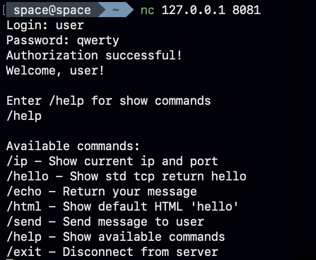

## TCP Server (C++)

Simple TCP / HTTP messenger server written in C++ using low-level Linux sockets.



## 🚀 Features

• Two servers in one program.

• HTTP server on port `8080`.

• Chat server on port `8081`.

• Login only by username.

• Chat commands:
`/help`
`/ip`
`/hello`
`/echo`
`/html`
`/chat <username>`
`/back`
`/sent_messages`
`/session_messages`
`/exit`

• HTTP login page.

• HTTP menu page after successful login.

• HTTP chats page.

• HTTP personal dialog page:
`/chat/username`

• HTTP routes:
`/`
`/menu`
`/hello`
`/about`
`/chat`
`/logout`

• Web messages update without full page reload.

• User cannot login twice at the same time.

• 404 page for unknown routes.


## ⚙️ Requirements

• Docker (recommended).

• Or: Linux, g++, make.


## 💡 Build and Run

### Docker (recommended)

Build:

```bash
docker build -t chat-server .
```

Run:

```bash
docker run -p 8080:8080 -p 8081:8081 chat-server
```

### Manual (Linux only)

```bash
cd src && make && ../server
```

## Test

Run the HTTP parser, HTTP I/O, and TCP chat line tests on Linux or macOS with a C++17 compiler:

```bash
sh tests/run.sh
```

## 🏗️ Architecture

- Chat server uses **epoll** event loop — single thread monitors all connections, new clients are dispatched to a **ThreadPool**.
- HTTP server uses a simple accept loop with ThreadPool.

## 📁 Structure

```text
src/
├── chat/
├── http/
├── shared/
├── storage/
└── web/
    ├── pages/
    └── assets/
```


## 🌐 HTTP

Open in browser:

```text
http://127.0.0.1:8080/
```

Main pages:

```text
/
/menu
/chat
/chat/username
```

## 💬 Chat

Connect from terminal:

```bash
nc 127.0.0.1 8081
```

Then enter only your username.

## Security scope

This is a demo with username-only login and unencrypted HTTP/TCP. Session IDs are
random, but they do not verify a user's identity or protect traffic in transit.
Do not expose the server to untrusted networks.
