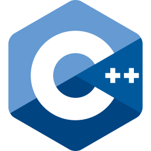

<h1 align="center">TCP + HTTP Chat Server</h1>

<p align="center">
  
</p>

<p align="center">A small C++17 messenger built with Linux sockets, epoll, and separate HTTP and chat thread pools.</p>

<p align="center">
  <a href="LICENSE">
    
  </a>
  <a href="src/makefile">
    
  </a>
  <a href="Dockerfile">
    
  </a>
  <a href="Dockerfile">
    
  </a>
  <a href="tests/run.sh">
    
  </a>
</p>

## What it does

- Serves a browser interface on HTTP port `8080` and a line-based TCP chat on port `8081`.
- Lets users sign in with a username, see other active users, and exchange private messages across the web and TCP interfaces.
- Keeps sessions and messages in memory. The browser refreshes an open dialog once per second; there is no WebSocket connection.
- Includes focused tests for HTTP parsing and I/O, session handling, and TCP chat behavior.

## Quick start

From the repository root, build the Linux image:

```sh
docker build -t chat-server .
docker run --rm \
  --publish 127.0.0.1:8080:8080 \
  --publish 127.0.0.1:8081:8081 \
  chat-server
```

Open <http://127.0.0.1:8080/> and enter a username. To use the terminal interface, connect in another terminal:

```sh
nc 127.0.0.1 8081
```

Enter a username when prompted, then type `/help` to see the available commands. Use a different username in each active browser or terminal session. Stop the server with `Ctrl+C`.

The image starts the server from `/app/src`, so it finds the HTML, CSS, and JavaScript files without an extra `--workdir` option.

### Build without Docker

On Linux, install `g++` and `make`, then run from the repository root:

```sh
make -C src
cd src
../server
```

The server must start with `src/` as its working directory so it can find `web/pages` and `web/assets`.

## Interfaces

| Address | Purpose |
| --- | --- |
| `http://127.0.0.1:8080/` | Username sign-in |
| `/menu` | Browser menu after sign-in |
| `/chat` | Active users and conversations |
| `/chat/<username>` | Private dialog with an active user |
| `/inspect` | HTTP request and server details |
| `127.0.0.1:8081` | Line-based terminal chat |

In the terminal, `/chat <username>` opens a private dialog, `/back` leaves it, `/who` lists connected TCP users, and `/exit` disconnects. `/help` lists the other commands.

## How it works

The HTTP listener uses an accept loop. The chat listener uses `epoll` to wait for incoming connections. Each listener has its own pool of eight workers, so idle TCP chat clients cannot consume HTTP workers. Each worker handles its client with blocking I/O. The current `epoll` loop does **not** monitor established chat connections.

Messages and sessions live in process memory, so restarting the server clears them. The browser polls `/chat-data/<username>` every second for new messages.

```text
src/main.cpp          starts both listeners and their separate thread pools
src/server/           epoll accept loop and thread pool
src/chat/             TCP commands, client tracking, and authorization
src/http/             HTTP request handling, responses, and pages
src/storage/          in-memory messages and sessions
src/web/              HTML, CSS, and JavaScript
tests/                focused C++ regression tests
```

## Tests

Run the test suite from the repository root with a C++17 compiler on Linux or macOS:

```sh
sh tests/run.sh
```

The runnable server uses Linux `epoll`; the tests can also run on macOS because they compile the portable components separately.

To check that idle chat connections do not stall HTTP on Linux, build the server and run:

```sh
make -C src
python3 tests/http_under_idle_chat_test.py ./server
```

## Security and limits

This is a local demo, not an Internet-facing chat service. Login checks a username but does not verify identity. HTTP and TCP traffic is unencrypted. Session IDs are random, but they cannot compensate for the missing authentication and transport encryption. Messages and sessions are not persisted.

The Docker command publishes both ports only on localhost. The native server binds all network interfaces; run it only on a trusted machine or restrict ports `8080` and `8081` with a firewall.

## License

This project is released under the [MIT License](LICENSE).
